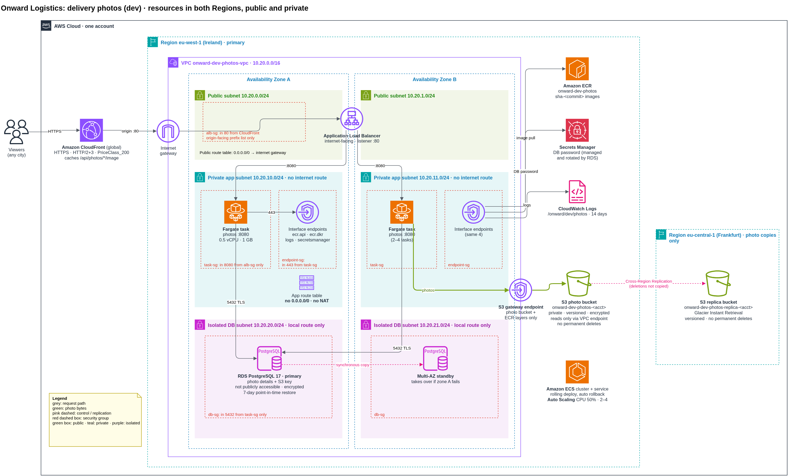

# Onward Logistics: Storing and Serving Delivery Photos (Week 5, Lab 1)

Infrastructure repository. Everything in AWS is created by CloudFormation, deployed by **CloudFormation Git sync** from this repository. The application code lives in a separate repository: [aws-db-s3-storage-app](https://github.com/jadofils/aws-db-s3-storage-app).

| | |
| --- | --- |
| Primary Region | `eu-west-1` (Ireland): network, application, database, photos |
| Second Region | `eu-central-1` (Frankfurt): a copy of every photo only |
| Naming | `onward-dev-photos-*` (company pattern `onward-<env>-<purpose>`) |
| Tags | `Project=onward`, `Owner=Jado Fils SEZIKEYE`, `Environment=dev` on every resource that supports tags |

## How a photo flows

```
Upload:  browser ──HTTPS──> CloudFront ──> ALB (public subnets) ──> ECS Fargate task (private subnets)
                                                                      ├─> S3 photo bucket (via gateway endpoint)  ──replication──> replica bucket (eu-central-1)
                                                                      └─> RDS PostgreSQL (isolated subnets): title, description, delivery ref, S3 key
View:    browser ──HTTPS──> CloudFront edge (cached photo)  ── on a miss ──> ALB ──> task ──> S3
```

The bucket is never reachable directly: Block Public Access is on, and the bucket policy refuses photo downloads that do not come through the VPC's S3 endpoint.



More detail, including the photo flow diagram, is in [docs/architecture](docs/architecture/README.md).

## Repository layout (separation of concerns)

| Folder | What it holds | Deployed by |
| --- | --- | --- |
| [infrastructure/bootstrap/](infrastructure/bootstrap/) | GitHub connection and the Git sync role: the deployment tool itself | By hand, once per Region |
| [infrastructure/templates/](infrastructure/templates/) | One template per concern (registry, network, storage, database, service, CDN) | Git sync |
| [infrastructure/deployments/dev/](infrastructure/deployments/dev/) | Parameter values for the `dev` environment, one file per stack | Git sync reads them |
| [docs/](docs/) | Discovery report, architecture, decisions, cost, demo script | Not deployed |
| [.github/workflows/validate.yml](.github/workflows/validate.yml) | gitleaks, cfn-lint, no inline policies, no IAM users | GitHub Actions on every PR and push |

## Stacks, in creation order

| # | Stack | Region | Template | Needs |
| --- | --- | --- | --- | --- |
| 1 | `onward-dev-photos-registry` | eu-west-1 | [1-registry.yaml](infrastructure/templates/1-registry.yaml) | n/a |
| 2 | `onward-dev-photos-network` | eu-west-1 | [2-network.yaml](infrastructure/templates/2-network.yaml) | n/a |
| 3 | `onward-dev-photos-replica-storage` | **eu-central-1** | [3-replica-storage.yaml](infrastructure/templates/3-replica-storage.yaml) | n/a |
| 4 | `onward-dev-photos-storage` | eu-west-1 | [4-storage.yaml](infrastructure/templates/4-storage.yaml) | 2, 3 |
| 5 | `onward-dev-photos-database` | eu-west-1 | [5-database.yaml](infrastructure/templates/5-database.yaml) | 2 |
| 6 | `onward-dev-photos-service` | eu-west-1 | [6-service.yaml](infrastructure/templates/6-service.yaml) | 1 (an image), 2, 4, 5 |
| 7 | `onward-dev-photos-cdn` | eu-west-1 | [7-cdn.yaml](infrastructure/templates/7-cdn.yaml) | 6 |

## Setting it up from nothing

1. **Bootstrap, eu-west-1.** CloudFormation console → create stack `onward-dev-photos-gitsync-bootstrap` from [gitsync-bootstrap.yaml](infrastructure/bootstrap/gitsync-bootstrap.yaml) with `CreateGitSyncRole = true`.
2. **Bootstrap, eu-central-1.** Same template, same stack name, in Frankfurt, with `CreateGitSyncRole = false`. The role is global and already exists.
3. **Approve both connections.** Developer Tools → Settings → Connections, in each Region: *Update pending connection*, then give access to both repositories.
4. **App repository ID.** Run `gh api repos/jadofils/aws-db-s3-storage-app --jq .id` and put the number in `AppRepositoryId` in [deployments/dev/1-registry.yaml](infrastructure/deployments/dev/1-registry.yaml).
5. **Create the stacks with Git sync**, in the order above: *Create stack → Sync from Git*, repository `database-storage-s3-cloud`, branch `main`, the deployment file of that stack, and role `onward-dev-photos-gitsync-role`. Create stack 3 from the **eu-central-1** console.
6. **First image.** After stack 1:
   - In the app repository, set the variables `AWS_ROLE_ARN` (the registry stack's output `GitHubActionsRoleArn`) and `AWS_REGION=eu-west-1`.
   - Run **Build and push image** from the Actions tab.
   - Put the printed `sha-<commit>` in `ImageTag` in [deployments/dev/6-service.yaml](infrastructure/deployments/dev/6-service.yaml) before creating stack 6.
7. **Open the app.** The URL is the output `PhotoServiceUrl` of `onward-dev-photos-cdn`.

## Releasing a new application version

The app repository's CD workflow pushes `sha-<commit>` to ECR. To release it:
- change `ImageTag` in [deployments/dev/6-service.yaml](infrastructure/deployments/dev/6-service.yaml) and merge;
- Git sync updates the task definition;
- ECS replaces the containers one at a time, and rolls back by itself if the new ones fail health checks.

Every release is therefore a reviewed commit in Git.

## Tearing it down

Delete the stacks in this order: 7, 6, then 5 (set `DeletionProtection: 'false'` and merge first), then 4, 2, 3 and 1. Both photo buckets and the final database snapshot are **kept on purpose** (`DeletionPolicy: Retain` / `Snapshot`): they are evidence. Remove them by hand only if the photos are truly no longer needed.

## Documents

- [Discovery report](docs/discovery-report/README.md)
- [Architecture](docs/architecture/README.md)
- [Decisions](docs/decisions/README.md)
- [Cost](docs/cost/README.md)
- [Demo: the client's checks](docs/demo/README.md)
