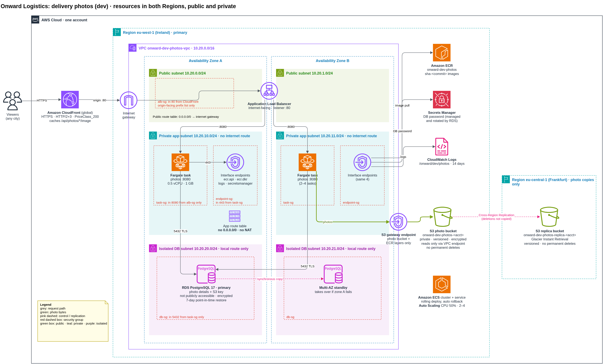
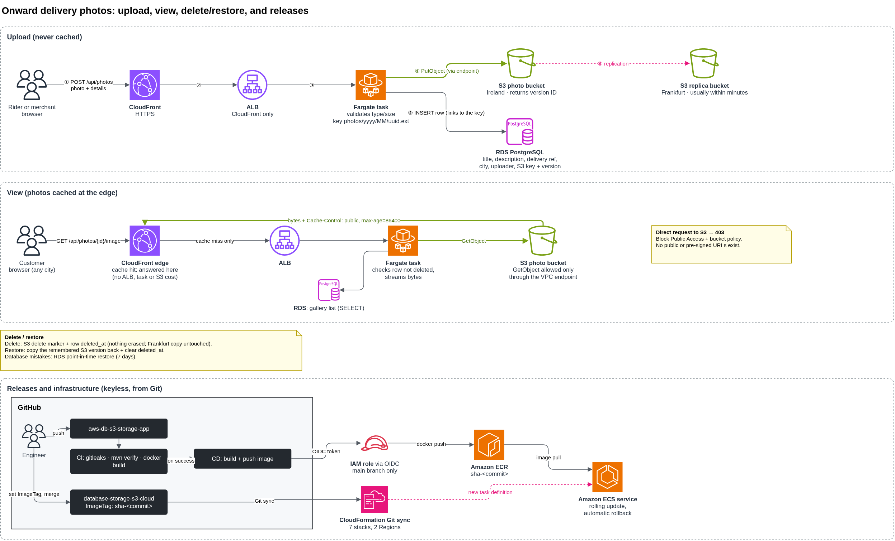

# Architecture

## Two Regions

| Region | What is there | Why |
| --- | --- | --- |
| `eu-west-1` Ireland (primary) | VPC, ALB, ECS Fargate, RDS PostgreSQL, photo bucket, ECR, CloudFront origin | Everything the service needs to run. The lab keeps the app and database in one Region. |
| `eu-central-1` Frankfurt (second) | Replica photo bucket only | Only the photos need to survive the loss of a Region. Frankfurt keeps the copy in the EU, under the same data rules. London and Paris are closer, but this lab account's organization policy does not allow them. |

## Network in eu-west-1 (VPC `10.20.0.0/16`, two Availability Zones)

| Tier | Subnets | Public or private | What runs there | Route to the internet |
| --- | --- | --- | --- | --- |
| Public | `10.20.0.0/24`, `10.20.1.0/24` | **Public** | Application Load Balancer | Yes (internet gateway) |
| App | `10.20.10.0/24`, `10.20.11.0/24` | Private | ECS Fargate tasks, interface endpoints | **No** (no NAT) |
| Database | `10.20.20.0/24`, `10.20.21.0/24` | Private, isolated | RDS primary and Multi-AZ standby | **No** (local route only) |

**VPC endpoints** (in place of a NAT gateway):
- S3 *gateway* endpoint, used for photos and for ECR image layers;
- *interface* endpoints for `ecr.api`, `ecr.dkr`, `logs` and `secretsmanager`.

**Security groups**: each tier accepts only the tier in front of it.

| Security group | Accepts | From |
| --- | --- | --- |
| `alb-sg` | TCP 80 | CloudFront origin-facing prefix list only |
| `task-sg` | TCP 8080 | `alb-sg` only |
| `db-sg` | TCP 5432 | `task-sg` only |
| `endpoint-sg` | TCP 443 | `task-sg` only |

## How a photo flows

**Upload**
1. The browser sends the photo and its details over HTTPS to **CloudFront**.
2. CloudFront passes the upload to the **ALB**. Uploads are never cached.
3. The ALB forwards it to a **Fargate task** in a private subnet.
4. The task generates a key `photos/<yyyy>/<MM>/<uuid>.<ext>` and puts the file in the **S3 photo bucket**, through the gateway endpoint. S3 returns a version ID.
5. The task writes a row to **RDS** with the title, description, delivery reference, city, who uploaded it, and the S3 key and version. The key links the record to its photo.
6. **S3 replication** copies the new photo to the **replica bucket in eu-central-1**, usually within minutes.

**View**
1. The gallery page asks `/api/photos` for the list (details from RDS, never cached).
2. Each photo is shown from `/api/photos/<id>/image`.
3. On the first request, CloudFront fetches it from the ALB. The task streams it from S3 and sends `Cache-Control: public, max-age=86400`.
4. Later viewers near the same edge location get it straight from the CloudFront cache, without reaching the task or S3.

**Delete and restore**
- Deleting adds an S3 delete marker and sets `deleted_at` on the row. Nothing is erased.
- Restoring copies the remembered S3 version back over the delete marker and clears `deleted_at`.
- Delete markers are not replicated, so the Frankfurt copy is never affected.

## Diagram

Editable source: [architecture.drawio](architecture.drawio) (open in [diagrams.net](https://app.diagrams.net)). It uses the official AWS architecture icons.

**Page 1: resources in both Regions, public and private**

**Page 2: how a photo flows (upload, view, delete/restore) and how releases happen**

